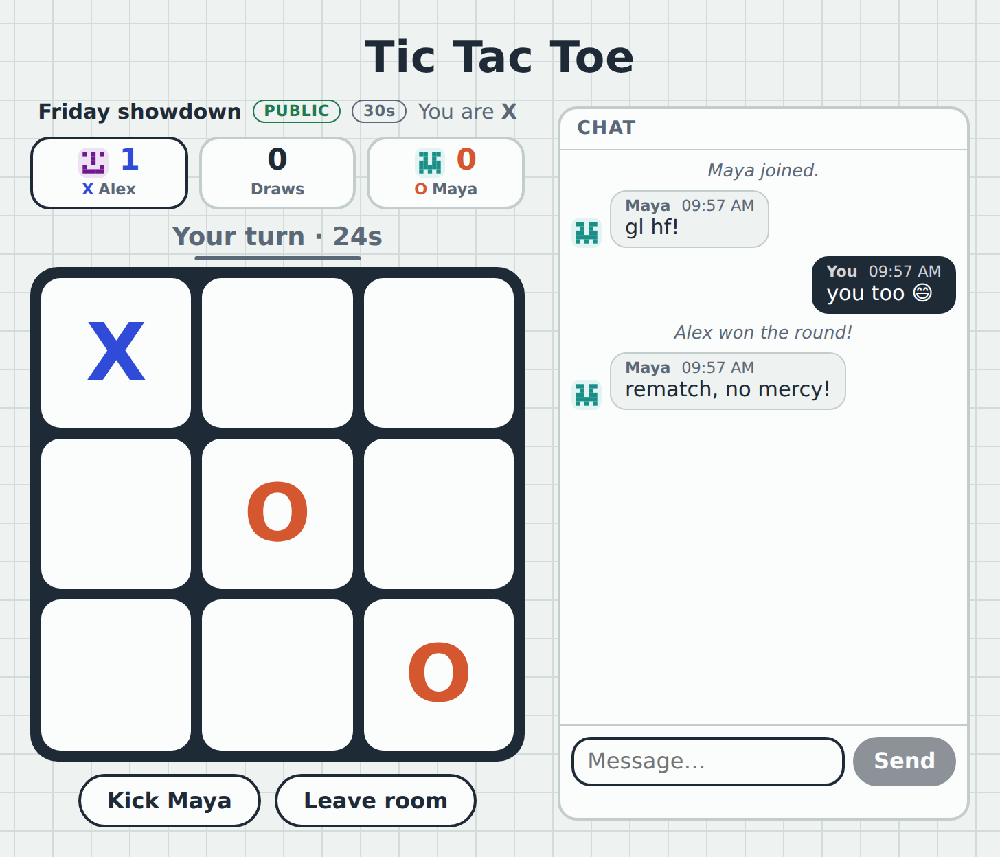
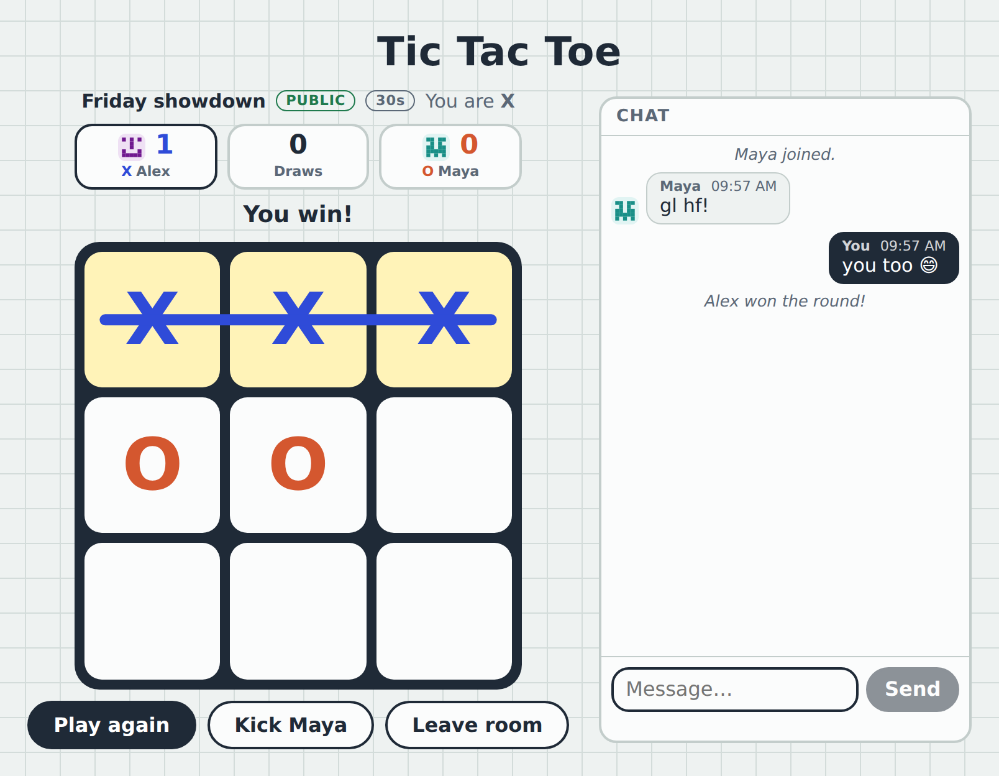
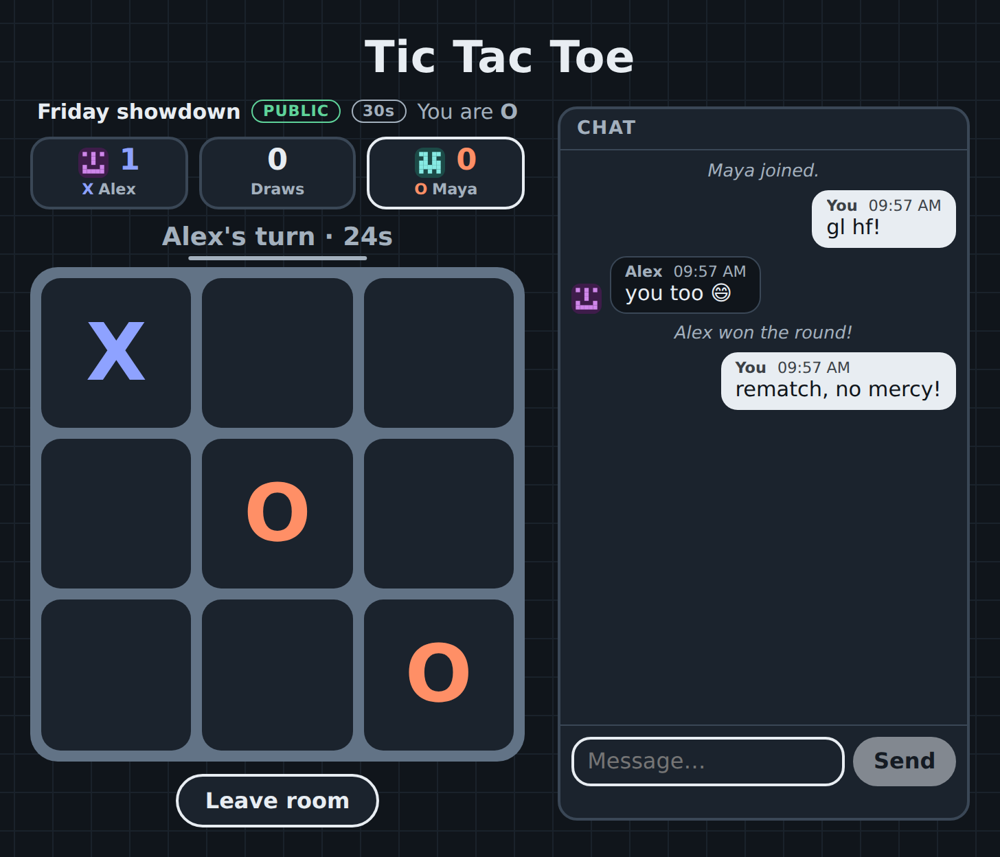
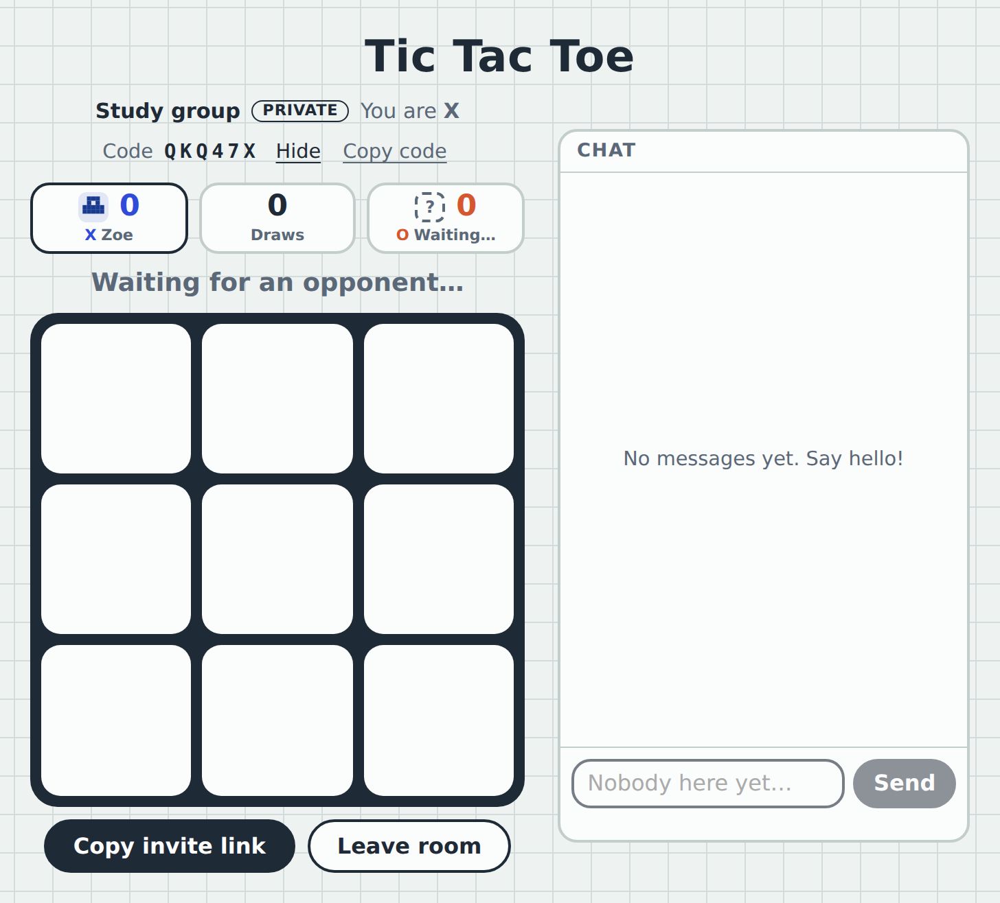
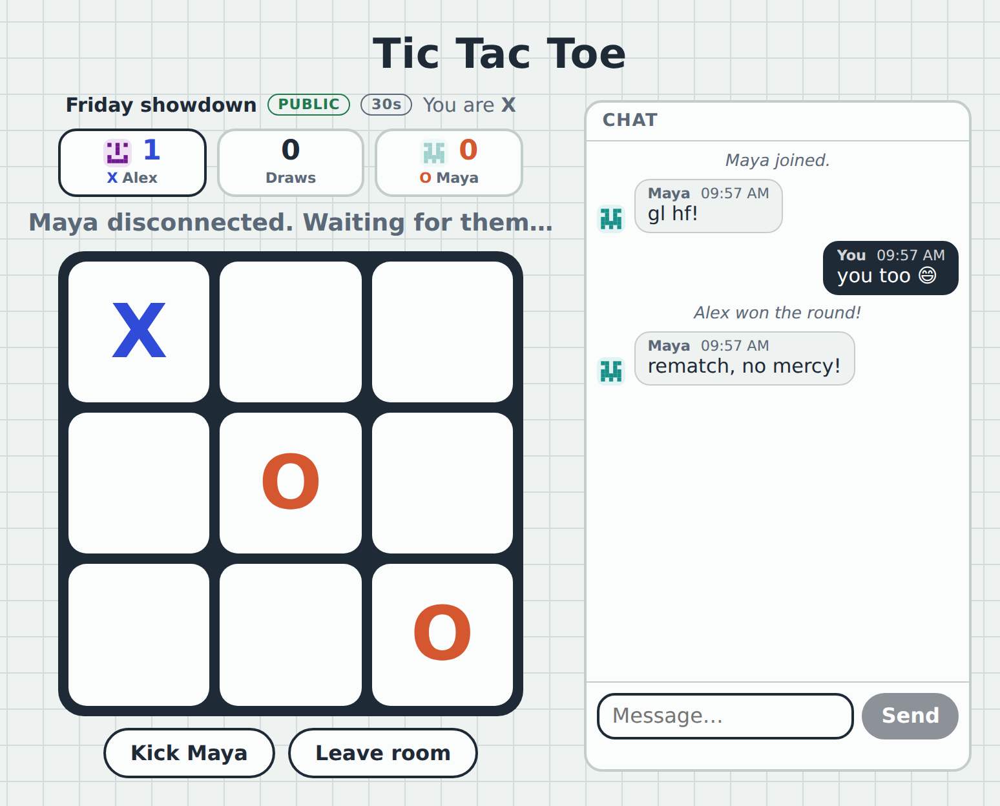
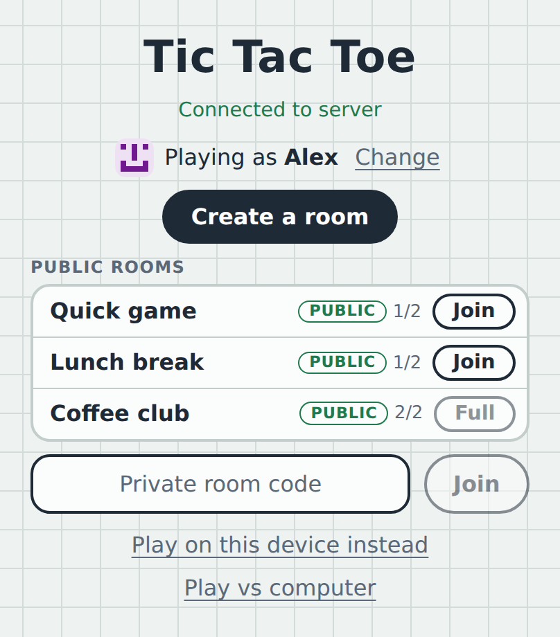
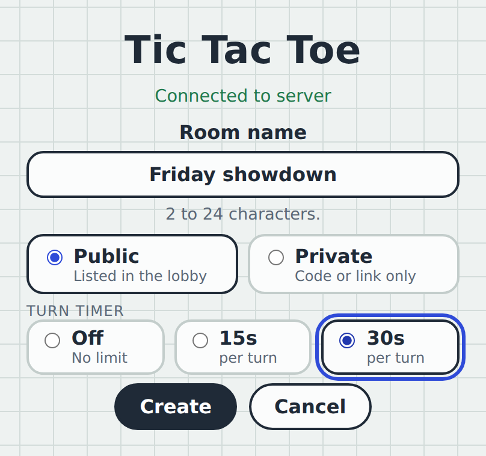
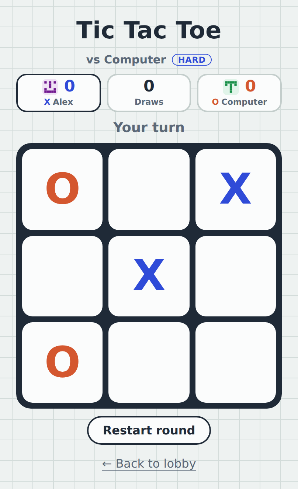
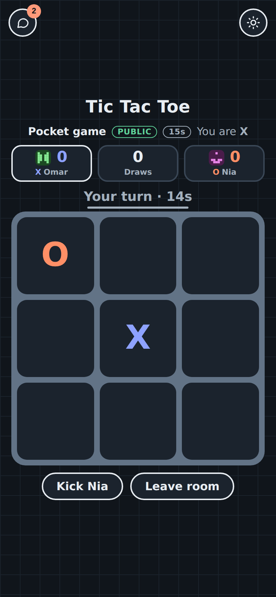
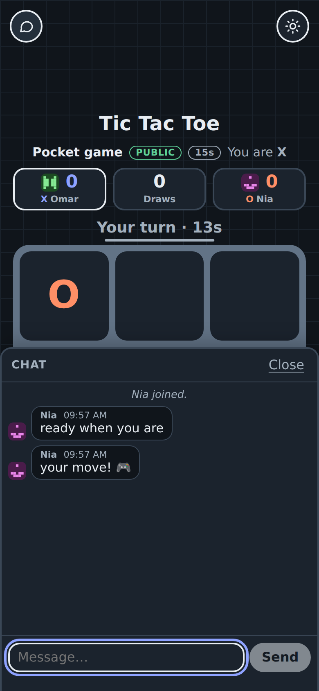

# Tic Tac Toe Online

[](https://github.com/Nitesh2747/tic-tac-toe-pw/actions/workflows/tests.yml)

Real-time multiplayer Tic Tac Toe in the browser. Play in public or private rooms with usernames and avatars, a scoreboard, an optional turn timer and live chat, or play against the computer when nobody is around. Built with React, Express and Socket.IO.

**▶ Live website link: [Tic Tac Toe](https://tic-tac-toe-pw.vercel.app)**

> The server runs on Render's free plan, which sleeps when idle. The first visit after a quiet spell can take up to a minute to wake up, so if the lobby says it's connecting, give it a moment.

<p align="center">
  
</p>

**Contents:** [Features](#features) · [A tour](#a-tour) · [How it works](#how-it-works) · [The protocol](#the-protocol) · [Project structure](#project-structure) · [Getting started](#getting-started) · [Configuration](#configuration) · [Tests](#tests) · [Discord bot](#discord-bot) · [Deploying](#deploying) · [Security notes](#security-notes) · [Known limitations](#known-limitations) · [What's next](#whats-next)

The code is split into three small apps, each with its own README: [`client/`](client/README.md) (the React front end), [`server/`](server/README.md) (the Express and Socket.IO back end) and [`bot/`](bot/README.md) (a Discord bot that plays the same game).

## Features

**Ways to play**

- **Online, public rooms.** Create a room and it shows up in everyone's lobby. Join by clicking it.
- **Online, private rooms.** Never listed anywhere. Share a 6-character code or an invite link.
- **Against the computer**, with no server needed. *Easy* plays at random, *Medium* takes a win and blocks yours, *Hard* uses minimax and never loses.
- **Same device**, two people taking turns.

**In an online room**

- **Usernames and avatars.** Pick a name (2 to 16 characters). Your avatar is a pixel-art identicon generated from a random seed, so there is nothing to upload.
- **Scoreboard.** Wins, losses and draws per room. The player who starts alternates every round. The score stays when the same person comes back, and resets if a different person takes the seat.
- **Turn timer (optional).** The host picks off, 15 s or 30 s when creating the room. When time runs out the server plays a random legal move. The clock pauses while anyone is disconnected.
- **Chat.** Plain text, up to 200 characters, the last 50 messages kept. System lines announce joins, leaves, removals and round results.
- **Host controls.** The first player in a room is the host and can remove the opponent. A removed player cannot rejoin, and a private room's code changes.
- **Survives bad connections.** Refresh the page, lose wifi or lock your phone: your seat is held for 60 seconds, the game pauses with a notice, and a *Rejoin* button brings you back.

**Interface**

- Light and dark themes, following your system setting and remembered after you change it.
- A line is drawn through the winning three tiles.
- Built to fit the screen without page scrolling, from phones to desktop. Chat sits beside the board on wide screens and opens as a bottom sheet (above the keyboard, with an unread badge) on narrow ones.
- Keyboard friendly, with visible focus. Every square has a text label such as "Row 1, column 2, empty", the status and chat are live regions, and animation respects `prefers-reduced-motion`.
- Works over plain `http://` on a local network too (copy-to-clipboard and ID generation have fallbacks for insecure contexts).

## A tour

<p align="center">
  <br>
  <em>A won round. The line is drawn over the three winning tiles, and the chat announces the result.</em>
</p>

<p align="center">
  <br>
  <em>The same game from the other player's side, in the dark theme.</em>
</p>

<p align="center">
  <br>
  <em>A private room. The code is only visible to the people sitting in it; the host can show, hide and copy it.</em>
</p>

<p align="center">
  <br>
  <em>The opponent's connection dropped. The game pauses and the turn timer stops, and their seat is held for 60 seconds.</em>
</p>

<table>
  <tr>
    <td align="center"><br><sub><b>Lobby</b><br>only public rooms are listed</sub></td>
    <td align="center"><br><sub><b>Create a room</b><br>name, visibility, turn timer</sub></td>
    <td align="center"><br><sub><b>Computer opponent</b><br>works with no server</sub></td>
  </tr>
</table>

<table>
  <tr>
    <td align="center"><br><sub><b>On a phone</b><br>unread badge on the chat button</sub></td>
    <td align="center"><br><sub><b>Chat as a bottom sheet</b><br>stays above the keyboard</sub></td>
  </tr>
</table>

## How it works

### The big idea

**The server is the single source of truth.** Browsers never decide anything. They send a request ("I click square 4") and the server checks it (is it your room, your turn, an empty square, is the game still going?), applies it, and sends the new state to everyone in the room. Because there is only one copy of the truth, the two players can never disagree about the board, and a modified client cannot cheat.

```text
 Browser A ──┐                                ┌── Browser B
 (React)     │   game:move {index}            │   (React)
             ├──────────────►  Server  ───────┤
             │                (rooms live     │
             ◄─ game:state ──  in memory)  ───► game:state
```

### Who is who

A player is identified by a random **`playerId`** that the browser creates once and keeps in `localStorage`, *not* by their socket. A socket is just a connection and changes every time you refresh or lose wifi. Because the seat belongs to the `playerId`, you can come back on a new connection and pick up exactly where you were. The `playerId` is a secret: it is never sent to anyone else, and the public state only says which *seat* (`X` or `O`) is the host.

### Rooms: public, private, and the host

- **Public rooms** appear in the lobby and are joined by their ID.
- **Private rooms** are joined by a 6-character code (letters and digits with look-alikes such as `0/O` and `1/I` removed) or an invite link of the form `/?code=ABC123`. The code is only sent to people sitting in the room, never to the lobby. Wrong guesses are rate limited, and the limit is checked *before* the code is looked at, so a blocked client cannot tell whether a guess was right.
- The first player to sit down is the **host**. If the host leaves, the role passes to the other player.
- Removing a player **bans their `playerId`** from that room and, for private rooms, **replaces the code**, so a removed player cannot simply type it again.

### A turn, from click to screen

1. You click a square and the client sends `game:move { index }`.
2. The server checks that you are seated, the opponent is present, it is your turn, the square is empty and the game is not over. If anything is wrong it replies `{ ok: false, error }` and nothing changes.
3. The server plays the move and broadcasts `game:state` to everyone in the room, including you.
4. Each browser draws the board from that state. The winner and the winning line are not stored anywhere: both browsers work them out from the board with the same pure function in `logic.js`.
5. If the move ended the round, the server updates the scoreboard and writes a line in the chat.

### Disconnects and reconnecting

Losing a connection is **not** leaving. The server marks the seat as disconnected, tells the other player ("Maya disconnected. Waiting for them…"), pauses the game and the turn timer, and starts a 60 second grace period. If the player comes back in time (refresh, wifi returns), they send `room:join` with the same `playerId` and the same seat is theirs again. If not, the seat is freed. The browser remembers the last room in `sessionStorage` (for refreshes) and `localStorage` (for a closed tab), which is how the *Rejoin* button knows where to go.

### The turn timer

The timer lives on the server, never in the browsers. When both players are present and it is somebody's turn, the server starts a timeout. If it fires, the server plays a random legal move for that player and sends `game:timeout { seat, index }` followed by the new `game:state`. Every move, reset, join, leave or disconnect re-syncs the timer, which only restarts when it is actually a different turn. Clients are sent the **time remaining** (`turnMsLeft`), not a deadline, so a wrong clock on someone's device cannot matter.

### Chat

- **The sender comes from the server's record of the seat**, never from the message. Sending `{ text, name: "Admin" }` does nothing: the server ignores everything but `text`.
- Text is cleaned on the server: whitespace is collapsed, control characters and invisible direction-override characters are removed, and anything over 200 characters is refused. React renders it as plain text, so markup such as `` is shown literally.
- Each player may send 5 messages per 5 seconds.
- The last 50 messages are kept per room and sent to a player when they join or rejoin. If a **different person** takes a seat, the chat is cleared for both players (the same rule as the score), so a newcomer never reads a conversation they were not part of.

## The protocol

All client-to-server events take an acknowledgement callback and answer `{ ok: true, … }` or `{ ok: false, error }`.

**Client to server**

| Event | Payload | Reply on success |
| --- | --- | --- |
| `room:create` | `{ playerId, name, avatarSeed, roomName?, visibility: "public" \| "private", turnSeconds: 0 \| 15 \| 30 }` | `{ ok, role: "X", state, code?, chat }` |
| `room:join` | `{ playerId, name, avatarSeed, roomId }` for a public room (or a seat you already hold), or `{ …, code }` for a private one | `{ ok, role, state, code?, chat }` |
| `room:leave` | none | `{ ok }` |
| `room:kick` | `{ seat: "X" \| "O" }` (host only) | `{ ok }` |
| `game:move` | `{ index: 0–8 }` | `{ ok }` |
| `game:reset` | none (only after a finished round) | `{ ok }` |
| `chat:send` | `{ text }` | `{ ok }` |
| `lobby:subscribe` | none | `{ ok, rooms }` |
| `lobby:unsubscribe` | none | `{ ok }` |

`code` is only present for private rooms, and only in replies to players sitting in them.

**Server to client**

| Event | Payload | Sent when |
| --- | --- | --- |
| `game:state` | the room's public state (below) | after every change in the room |
| `game:timeout` | `{ seat, index }` | the turn timer ran out and a random move was played |
| `chat:message` | one message (below) | someone speaks, or the server writes a line |
| `chat:history` | `{ messages }` | the chat was replaced (a different person took a seat) |
| `room:code` | `{ code }` | a private room's code changed after a removal |
| `room:kicked` | `{ message }` | to the removed player |
| `lobby:rooms` | `[{ id, name, display, players, full }]` | to lobby subscribers, batched; public rooms only, at most 100 |

**A room's public state** is everything a browser needs to draw the room, and nothing secret: no `playerId`, no code, no host ID.

```json
{
  "roomId": "k3n9x2q7ab",
  "name": "Friday showdown",
  "visibility": "public",
  "hostSeat": "X",
  "turnSeconds": 30,
  "turnMs": 30000,
  "turnMsLeft": 24310,
  "board": ["X", null, null, null, "O", null, null, null, "O"],
  "xIsNext": true,
  "status": "playing",
  "scores": { "X": 1, "O": 0, "draws": 0 },
  "players": {
    "X": { "name": "Alex", "avatarSeed": "e4b8d27c0f91a365", "connected": true },
    "O": { "name": "Maya", "avatarSeed": "19f6c3a8d54e072b", "connected": true }
  }
}
```

**A chat message** is either from a player or a line written by the server:

```json
{ "id": 7, "seat": "O", "name": "Maya", "avatarSeed": "19f6c3a8d54e072b", "text": "gl hf!", "at": 1761985440000 }
{ "id": 8, "system": true, "text": "Alex won the round!", "at": 1761985452000 }
```

### Design decisions, briefly

- **Derived state is never stored.** The winner, the winning line and "whose turn" come from the board, so they can never contradict it.
- **One rules file, two copies.** `logic.js` (the rules, plus the computer opponent) is used by both the browser and the server. It is copied into `client/src/game/` and `server/game/` rather than shared as a package, to keep setup simple. The two copies must stay identical.
- **Validate at the edge.** Everything from a browser (names, room names, avatar seeds, chat text, the timer setting, moves) is checked before it touches a room.
- **Acknowledgements for everything that can fail**, so the UI can show a real error ("Room is full", "You were removed from this room") instead of silently doing nothing.
- **Lobby updates are throttled** into batches, and the list is capped, so a burst of activity sends one update instead of hundreds.
- **Limits protect memory**: at most 1000 rooms, 100 listed in the lobby, 50 chat messages per room, and small network messages only (`maxHttpBufferSize` is 10 KB).

## Project structure

```text
.
├── client/                       React + Vite front end
│   └── src/
│       ├── App.jsx               owns the socket, the session and which screen shows
│       ├── components/
│       │   ├── Lobby.jsx            lobby: public list, private code, create, offline modes
│       │   ├── RoomList.jsx         the list of public rooms
│       │   ├── CreateRoomForm.jsx   name, public or private, turn timer
│       │   ├── ProfileForm.jsx      choose a name
│       │   ├── OnlineGame.jsx       an online room: board, scoreboard, timer, host controls
│       │   ├── Game.jsx             offline game (same device, or against the computer)
│       │   ├── ComputerSetup.jsx    pick Easy, Medium or Hard
│       │   ├── OfflineLinks.jsx     the two "play without a server" links
│       │   ├── ChatPanel.jsx        messages and the message box
│       │   ├── Board.jsx, Square.jsx, Status.jsx, Scoreboard.jsx, Avatar.jsx, ThemeToggle.jsx
│       ├── game/                 plain JavaScript, no React, easy to test
│       │   ├── logic.js             the rules and the computer opponent (same as the server's)
│       │   ├── localGame.js         state of an offline game and its scoreboard
│       │   ├── winLine.js           where to draw the line through a win
│       │   ├── countdown.js         turn timer display helpers
│       │   ├── chat.js              chat list helpers
│       │   ├── viewport.js          keyboard-aware sizing for the chat sheet
│       │   ├── avatar.js, profile.js, invite.js, savedRoom.js, playerId.js, clipboard.js
│       │   └── socket.js            the one Socket.IO connection
│       └── hooks/                useTheme, useLobbyRooms, useProfile, useCountdown, useMediaQuery, useVisualViewport
├── server/                       Express + Socket.IO back end
│   ├── index.js                  HTTP server, CORS, /health, graceful shutdown
│   ├── config.js                 every setting, read from the environment in one place
│   ├── game/
│   │   ├── logic.js              the rules and the computer opponent (same as the client's)
│   │   └── room.js               rooms in memory: seats, scores, host, bans, public state
│   ├── handlers/                 one file per group of socket events
│   │   ├── roomHandlers.js       create, join, leave, kick, disconnect
│   │   ├── gameHandlers.js       move, reset
│   │   ├── lobbyHandlers.js      subscribe, unsubscribe
│   │   └── chatHandlers.js       send
│   └── lib/
│       ├── membership.js         leaving a room and the reconnect grace period
│       ├── turnTimer.js          the turn timer
│       ├── chat.js               cleaning and storing chat messages
│       ├── lobby.js              batched lobby updates
│       ├── rateLimit.js          sliding-window limits (wrong codes, chat)
│       ├── profile.js, validate.js   checking what browsers send
│       └── clientIp.js           finding a client's address, proxy-aware
├── bot/                          Discord bot (discord.js)
│   ├── index.js                  connects to Discord, closes idle boards
│   ├── scripts/deploy-commands.js   registers the /ttt slash command
│   ├── discord/                  commands, click handling, buttons, idle timeout
│   └── game/                     rules, game state, challenges (no Discord in here)
└── screenshots/             the images in this README
```

## Getting started

You need **Node.js 20.19 or newer** (or 22.12+), which is what Vite 8 requires.

```bash
# terminal 1: the server
cd server
cp .env.example .env
npm install
npm run dev          # http://localhost:3001, restarts when you save

# terminal 2: the client
cd client
cp .env.example .env # points the client at the local server
npm install
npm run dev          # http://localhost:5173
```

Open <http://localhost:5173>, pick a name, and create a room.

**To play against yourself, use two different browsers**, or one normal window and one private window. Your player identity lives in `localStorage`, which tabs of the same browser share, so a second tab would just rejoin your own seat.

**To try it on your phone** over your home network, open the client at `http://<your-computer's-IP>:5173`, add that same address to `CLIENT_ORIGIN` in `server/.env` (comma-separated, next to the existing one), and set `VITE_SERVER_URL=http://<your-computer's-IP>:3001` in `client/.env`.

## Configuration

**Server** (`server/.env`, see [`server/.env.example`](server/.env.example)). Everything is read in one place, `server/config.js`.

| Variable | Default | What it does |
| --- | --- | --- |
| `CLIENT_ORIGIN` | `http://localhost:5173` | The browser origin(s) allowed to connect, comma-separated. Must match exactly: scheme, host and port, no trailing slash. |
| `PORT` | `3001` | Port to listen on. Hosts usually set this for you. |
| `TRUST_PROXY` | `false` | Set to `true` only when the server runs behind a proxy you control (Render, nginx…), so the client's address comes from `X-Forwarded-For`. See [Deploying](#deploying). |
| `RECONNECT_GRACE_MS` | `60000` | How long a disconnected player keeps their seat. |
| `LOBBY_THROTTLE_MS` | `300` | How long lobby changes are batched before one update is sent. |
| `CODE_FAIL_WINDOW_MS` | `60000` | The window for the wrong-code limits below. |
| `CODE_FAILS_PER_SOCKET` | `5` | Wrong private-room codes one connection may try per window. |
| `CODE_FAILS_PER_IP` | `30` | Wrong codes one IP address may try per window. |
| `CHAT_MAX_MESSAGES` | `5` | Chat messages one player may send per window. |
| `CHAT_WINDOW_MS` | `5000` | The chat limit's window. |
| `MAX_CONNECTIONS_PER_IP` | `20` | Connections one IP address may hold open at once. |
| `EVENT_LIMIT` | `40` | Events one connection may send per window. Over the limit, requests are refused, and a connection that keeps flooding is dropped. |
| `EVENT_WINDOW_MS` | `5000` | The event limit's window. |
| `ROOM_CREATES_PER_IP` | `10` | Rooms one IP address may create per window. |
| `ROOM_CREATE_WINDOW_MS` | `60000` | The room-creation limit's window. |
| `TURN_SECOND_MS` | `1000` | How long one "second" of the turn timer lasts. **For tests only**, so a 15 second timer can run in under a second. Leave it alone. |

**Client** (`client/.env`, see [`client/.env.example`](client/.env.example))

| Variable | What it does |
| --- | --- |
| `VITE_SERVER_URL` | The server's URL, for example `http://localhost:3001`. It is baked into the build, and `npm run build` fails if it is missing. |

**What the browser stores** (nothing leaves the device except what you send over the socket):

| Key | Storage | Holds |
| --- | --- | --- |
| `ttt-player-id` | `localStorage` | your random player ID (a secret) |
| `ttt-profile` | `localStorage` | your name and avatar seed |
| `ttt-theme` | `localStorage` | light or dark, once you choose |
| `ttt-room-id` | `sessionStorage` | this tab's room, so a refresh puts you back |
| `ttt-last-room` | `localStorage` | the last room, for the *Rejoin* button |

## Tests

```bash
cd server && npm test    # 270 tests (unit + socket integration)
cd client && npm test    # 120 tests
cd bot && npm test       # 106 tests
```

The tests are plain unit tests (Vitest) and run in a couple of seconds.

- **Rules and the computer opponent.** Every position that can occur in a game is checked against an independent solver: *Hard* never picks a worse move, never loses, and always wins from a lost position. *Medium* always takes a win and always blocks.
- **Rooms.** Seats, scores, host and bans, joining and rejoining, capacity limits, the turn timer (using fake clocks), chat cleaning, rate limits and the lobby list.
- **Safety.** Public state and the lobby list are checked to never contain a player ID or private code, and bad input (names, room names, timer settings, chat text, move positions) is checked to be refused.
- **Client helpers.** Avatars, name rules, invite links, saved rooms, the win line, offline game state, the countdown and keyboard sizing.

The server's socket events are covered by integration tests (a real server and real socket clients, in `server/integration/`), and the bot's click handling by tests with fake Discord interactions. All three suites run on every push in GitHub Actions. The React screens are not covered by browser-level tests yet, which is listed under [What's next](#whats-next).

## Discord bot

The same game is also a Discord bot: play in a channel with buttons, challenge another member (`/ttt challenge @someone`) or play the computer (`/ttt computer`). It reuses this project's game rules and computer opponent. Setup, commands and the code layout are in [`bot/README.md`](bot/README.md).

> The bot is not hosted currently on a service and runs itself locally on the machine; do it yourself with the steps in [`bot/README.md`](bot/README.md).

## Deploying

The live website runs like this:

| Part | Host | Settings |
|---|---|---|
| Website (`client/`) | Vercel | Root directory `client`; `VITE_SERVER_URL` = the Render address |
| Server (`server/`) | Render (free web service) | Root directory `server`; build `npm ci`; start `npm start`; health check `/health`; `NODE_VERSION=22.14.0`, `TRUST_PROXY=true`, `CLIENT_ORIGIN` = the Vercel address |

The client is a static site and the server is one long-running Node process.

- **Client:** build with `VITE_SERVER_URL` set to the server's public URL, and host the `dist/` folder anywhere that serves static files.
- **Server:** needs a host that keeps a process running and supports WebSockets. Set `CLIENT_ORIGIN` to the exact URL(s) of your deployed client, and `PORT` if your host does not.
- **`TRUST_PROXY=true` on a proxied host.** Render, and most hosts, put a proxy in front of your server. Without this setting, every visitor appears to come from the proxy's address and shares one rate-limit bucket for wrong private-room codes, so a few wrong guesses could lock everyone out. Only set it on a host that really does sit behind a proxy: otherwise anyone could fake their address by sending their own `X-Forwarded-For` header.
- **Run a single instance.** Rooms live in the server's memory, so two copies would each have their own rooms.
- A restart (including a redeploy) clears every room. The server shuts down cleanly when a host sends `SIGTERM`.
- `GET /health` returns `{ "ok": true }`, for health checks.

## Security notes

- The server decides everything, and every input from a browser is validated before use.
- Secrets stay on the server: player IDs and private codes are never in the public state, the lobby list or chat. The host is exposed as a seat (`X` or `O`), not an ID.
- Private codes are 6 characters from a 32-character alphabet, generated with `crypto.randomInt`. Guessing is limited per connection and per IP address, checked before the code is looked at, and the code changes when a player is removed.
- Chat is plain text only, cleaned on the server, rendered by React as text, and rate limited. The sender is always taken from the server's own record.
- Messages over 10 KB are refused, and memory is bounded (rooms, lobby entries, chat history and rate-limit tables are all capped).
- Browsers from other websites are refused at the socket handshake: only the origins in `CLIENT_ORIGIN` may connect. (Programs that send no Origin header are not blocked, so this is a browser-level guard, not a password.)
- Abuse limits: connections per IP address, events per connection and rooms created per IP address are all capped, and a connection that keeps flooding is dropped. A handler that throws is logged and answered with an error instead of stopping the server.
- The website is served with a Content-Security-Policy (no inline scripts, and the page may only connect to its own server), `Referrer-Policy: no-referrer` and other headers, set in `client/vercel.json`.
- Dependencies are checked weekly by GitHub Actions (`npm audit`) and updated through Dependabot pull requests.

## Known limitations

- **Everything is in memory.** Restarting the server clears all rooms, scores and chat. There is no database and no accounts.
- **Removal can be dodged.** A removed player is banned by their `playerId`, which they can reset by clearing their browser storage. There are no accounts to ban.
- **Public chat is open text between strangers**, with no profanity filter, reporting or muting. Removing a player is the only moderation.
- **The turn timer is chosen when the room is created** and cannot be changed afterwards.
- **One server only.** It cannot be spread across several instances without moving the rooms into shared storage.
- **No spectators.** A full room cannot be watched.
- **Browser coverage.** Developed and checked in Chromium and in Chrome on an Android phone. Firefox and Safari have not been tested.
- **No automated end-to-end tests** in the repository yet (see below).

## What's next

- **Hosting the Discord bot** on an always-on host, and optionally linking it to the website's rooms.
- **Spectators** (the lobby already hides full rooms, so there is room to add a "Watch" button).
- **Moderation and persistence:** reporting or muting in public rooms, and optional storage so rooms survive a restart.